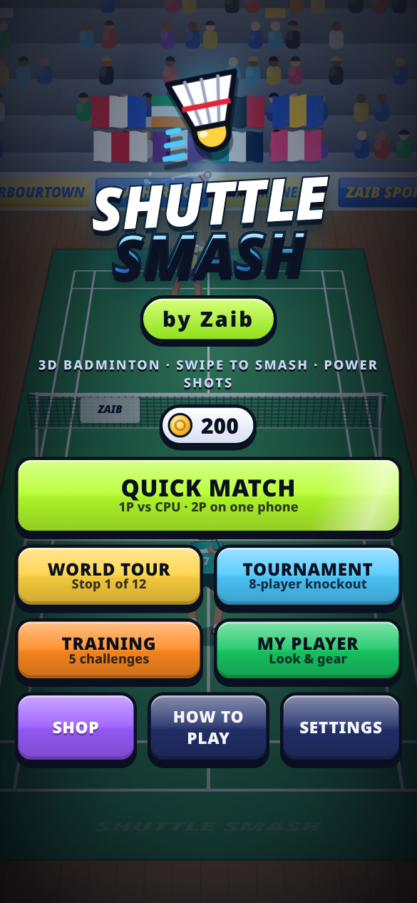
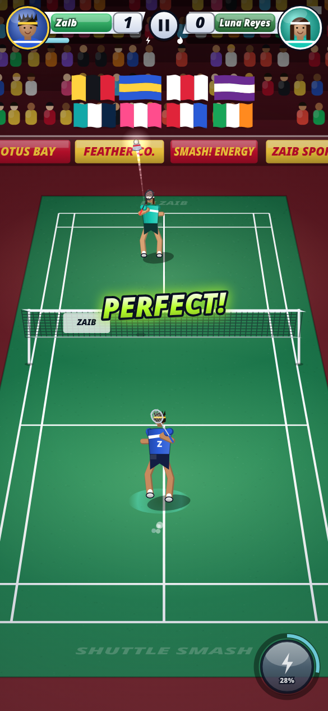
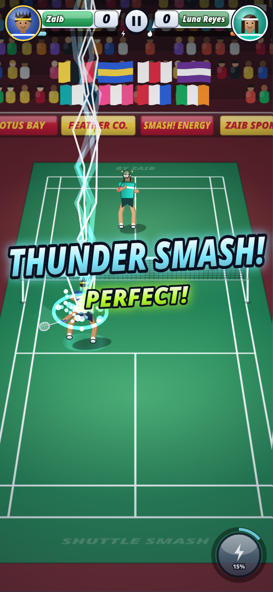
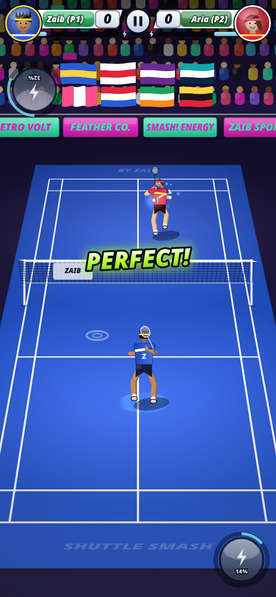

# Shuttle Smash — by Zaib

A polished mobile browser badminton game in a single self-contained HTML file (no dependencies).
Portrait 3D-perspective court, realistic shuttlecock physics (drag, tumbling feathers, trail),
assisted movement, swipe-to-hit controls, power shots and full career progression.

**Play:** https://wahidzeb.github.io/shuttle-smash/

## Modes
- **Quick Match — 1 Player** (vs CPU, 4 difficulties) or **2 Players** on one phone
- **World Tour** — 10 stages, fictional rivals across 5 venues (day/night arenas)
- **Zaib Open** — 8-player knockout bracket
- **Training** — 6 challenges with a coach

## Controls
- Your player auto-moves to the shuttle. **Swipe** to hit: direction = aim, length/speed = power.
  Short swipe = drop / net shot, long swipe = clear / lob, long swipe on a high shuttle = (jump) smash. **Tap** = auto shot.
- **Power button** (fills during rallies): Thunder Smash, Fire Clear, Phantom Drop, Tornado Shot.
- **2 Players:** sit facing each other. P1 swipes on the bottom half, P2 on the top half
  (P2's prompts and power button are rotated for them). Multi-touch, both can play at once.
- **Keyboard (1P):** Space auto, J/K/L soft/medium/hard, ←/→ aim, E power, P pause.
- **Keyboard (2P):** P1: A/D aim, Z/X/C shots, Space auto, Q power · P2: ←/→ aim, J/K/L shots, Enter auto, U power · Esc pause.

## Features
Rally scoring to 21 (win by 2, cap 30) or 11/15 points, best of 1 or 3 · coins, stat upgrades, rackets, outfits, powers ·
slow-mo, replays, commentator callouts, crowd reactions, generated WebAudio sound & music · saves in localStorage.

   

Game by Zaib.
